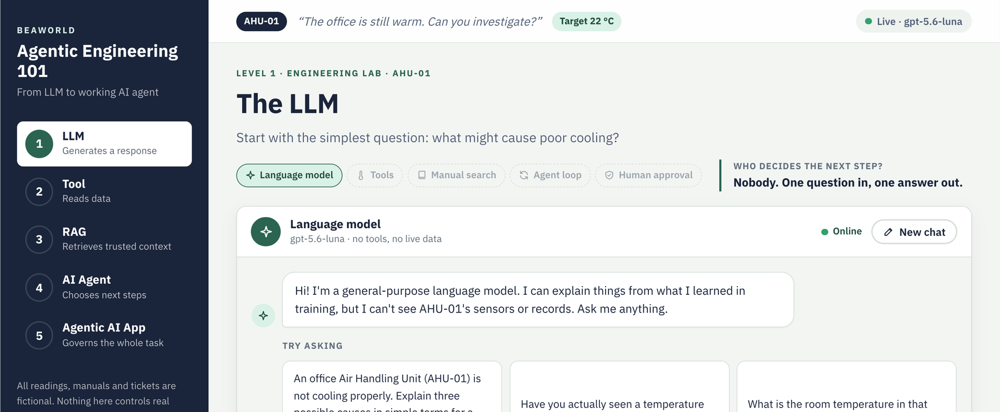
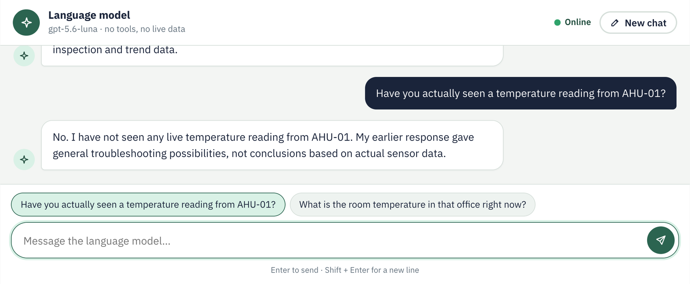
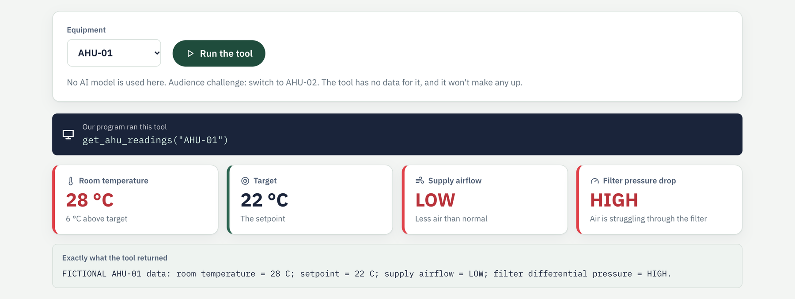
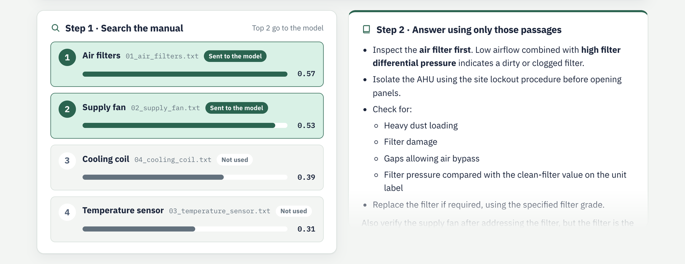
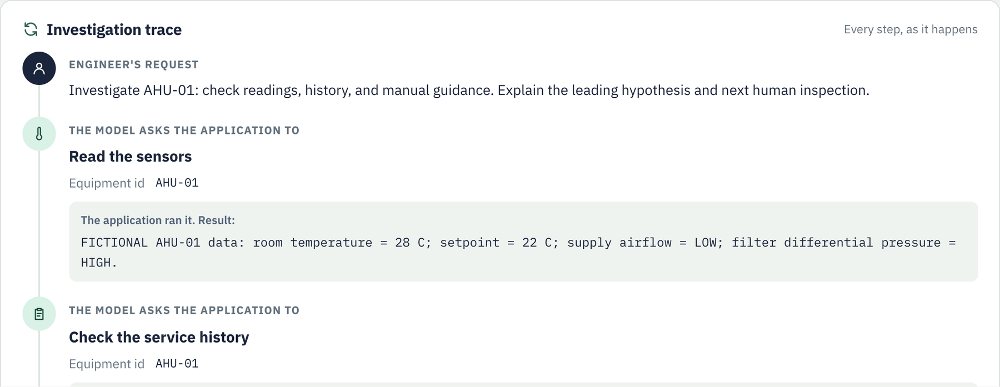
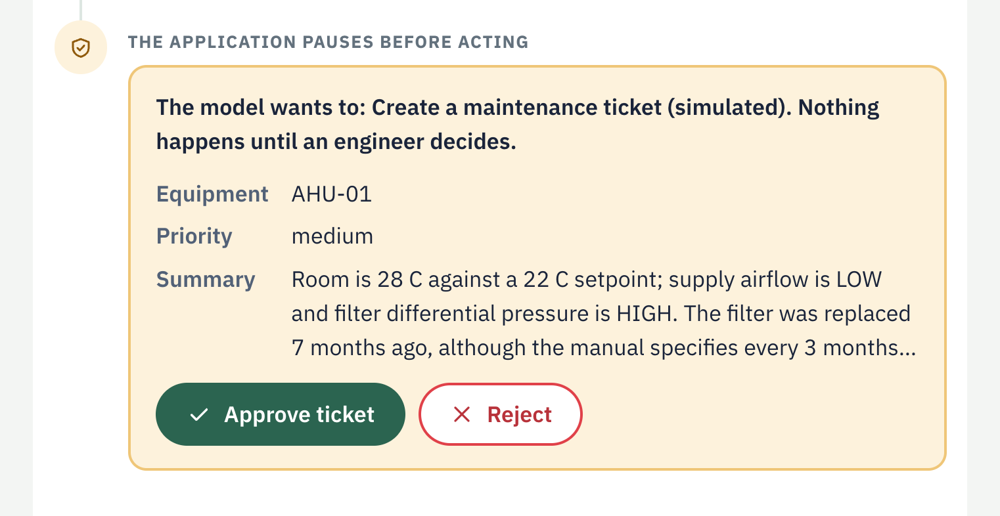

# BEAWorld · Agentic Engineering 101

A hands-on workshop for engineers and architects that goes from a plain **LLM** to a governed **agentic AI application**, in five levels.

Every level uses the same case study: **AHU-01**, an office Air Handling Unit that isn't cooling properly. All readings, manuals and tickets are fictional, and nothing connects to real equipment.



## What's in this repository

| Part | Folder | Use it for |
|---|---|---|
| **Browser demo** | [`backend/`](backend) + [`frontend/`](frontend) | The live demo. Every step is shown on screen. |
| **Python exercises** | [`code/`](code) | Five short scripts, one per level, for participants who want to read and run the code. |
| **Slides** | `BEAWorld_Agentic_Engineering_101_GUI_Demo.pptx` | The workshop deck; its exercise slides show the browser demo. |

## The five levels

| Level | Idea | What the audience sees | Who decides the next step? |
|---|---|---|---|
| 1 · LLM | The model generates a response | A chat. The answer streams in word by word, and no measurement is taken. | Nobody: one question, one answer |
| 2 · Tool | A function reads data | One click runs `get_ahu_readings`; the readings appear as tiles. No AI involved. | Our program |
| 3 · RAG | Retrieve evidence, then answer | Every manual section gets a match score; the top two go to the model, which cites them. | Our program: always search first |
| 4 · AI agent | The model chooses tools | A live trace as the model reads sensors, checks service history and searches the manual. | The model |
| 5 · Agentic AI app | Agent + state + approval | The same trace, then the app **pauses** on a ticket proposal until an engineer approves or rejects it. | The model proposes; an engineer approves |

<details>
<summary><strong>Screenshots of each level</strong></summary>

**Level 1: chat.** Asked whether it has seen a live reading, the model says it hasn't.


**Level 2: tool.** Our program runs the tool; no model is involved.


**Level 3: RAG.** Match scores, then an answer that cites the retrieved sections.


**Level 4: AI agent.** Every tool request and result, as it happens.


**Level 5: agentic AI application.** The application pauses before the ticket tool runs.


</details>

## Run the browser demo

You need Python 3.11 or newer and an OpenAI API key.

```bash
cd backend
python3 -m venv .venv
source .venv/bin/activate          # Windows: .venv\Scripts\activate
pip install -r requirements.txt
cp .env.example .env               # then put your key in OPENAI_API_KEY
python -m app
```

Your browser opens at **http://127.0.0.1:8791**. The badge at the top right reads `Live · gpt-5.6-luna` once the key is loaded; without a key, only Level 2 works. Press `Ctrl+C` in the terminal to stop the server.

### Presenting

- **Changing level:** `←` / `→`, `Page Up` / `Page Down` (most clickers send these), the keys `1`–`5`, or the sidebar.
- **"Question for the room":** each level has one. Ask it, then click **Reveal the answer**.
- **Audience challenges:**
  1. **LLM:** click the follow-up "Have you actually seen a temperature reading from AHU-01?"
  2. **Tool:** switch the equipment to **AHU-02**. The tool has no data for it and won't invent any.
  3. **RAG:** open **Audience challenge: edit the manual**, change a section and search again. The scores and citations change; the files on disk don't.
  4. **AI agent:** turn on **the filter was replaced last week** and run again. The service record changes, and so does the reasoning.
  5. **Agentic AI app:** run it twice. Approve once and reject once.
- Model answers and agent routes vary between runs. That is part of the lesson.

### Configuration (`backend/.env`)

| Variable | Default | Purpose |
|---|---|---|
| `OPENAI_API_KEY` | none | Required for Levels 1, 3, 4 and 5 |
| `BEA_MODEL` | `gpt-5.6-luna` | Chat model; it must support tool calling |
| `BEA_EMBEDDING_MODEL` | `text-embedding-3-small` | Used to search the manual |
| `OPENAI_BASE_URL` | none | An OpenAI-compatible server instead, for example a local vLLM |
| `BEA_USE_RESPONSES_API` | `1` (`0` with `OPENAI_BASE_URL`) | gpt-5.6-luna needs OpenAI's Responses API for tool calls; set `0` for servers without it |
| `BEA_PORT` | `8791` | Web server port |
| `BEA_HOST` | `127.0.0.1` | Set `0.0.0.0` only if others on the network must connect |
| `BEA_RATE_LIMIT_PER_MINUTE` | `30` | Runs allowed per browser per minute |
| `BEA_OPEN_BROWSER` | `1` | Set `0` to stop the browser opening automatically |

## Run the Python exercises

The scripts in [`code/`](code) cover the same five levels from the command line, using LangChain directly. See [`code/README.md`](code/README.md) for setup and the audience challenges. They default to `gpt-4.1-mini`; set `BEA_MODEL` to change it.

## How the browser demo works

- **One stream per run.** Each level calls `POST /api/levels/{n}/run`, and the backend streams newline-delimited JSON events (`token`, `tool_call`, `tool_result`, `approval_required`, `answer`, …) so the screen updates as each step happens.
- **Level 5 approval** uses LangChain's `HumanInTheLoopMiddleware` with an in-memory checkpointer. The run stops *before* the ticket tool executes; **Approve** or **Reject** calls `POST /api/levels/5/decision`, which resumes the saved investigation. Each pause can be answered only once.
- **Backend** (Python, FastAPI, LangChain): `LevelRunner` gives every level the same error handling and closing `done` event; `AgentLevelRunner` adds the agent stream; `WorkshopToolkit` builds the tools; `AgentTraceTranslator` turns agent updates into events.
- **Frontend** (plain HTML, CSS and JavaScript modules, no build step): `LevelView` handles layout, the busy state and event routing; each level subclasses it. Model text is HTML-escaped before it is formatted, and the page runs under a strict Content Security Policy.

```
beaworld-agentic-ai-demo/
├── backend/
│   ├── app/
│   │   ├── api/          routes, JSON envelope, NDJSON stream, rate limit, static files
│   │   ├── core/         model provider, prompts, events, friendly errors
│   │   ├── domain/       fictional equipment, manual and ticket desk
│   │   ├── services/     manual retriever, tool kit, agent-trace translator
│   │   ├── levels/       one runner per level, plus the registry
│   │   └── data/manual/  the four fictional manual sections
│   ├── requirements.txt
│   └── .env.example
├── frontend/
│   ├── index.html
│   ├── css/
│   └── js/               api/ · ui/ · ui/components/ · levels/
├── code/                 command-line exercises 1–5 and their shared tools
├── docs/images/          screenshots used in this README
└── BEAWorld_Agentic_Engineering_101_GUI_Demo.pptx   workshop slides
```

## Troubleshooting

| Symptom | Fix |
|---|---|
| `address already in use` | Another app is on the port. Set `BEA_PORT=8792` in `backend/.env`. |
| Badge says "No API key" | Add `OPENAI_API_KEY` to `backend/.env` and restart. |
| "The demo server isn't responding" | The backend stopped. Run `python -m app` again and refresh. |
| Level 5 says no ticket was proposed | The model answered in text this time. Click **Start the investigation** again. |
| The page looks out of date after an update | Hard-refresh once with `Cmd+Shift+R` (`Ctrl+Shift+R` on Windows). |
| Any other error on screen | The full details are in the terminal running the backend. |

## Safety

This is teaching material. The equipment data, manual and tickets are fictional, and the ticket tool is simulated. Never connect this example to actuators or safety-critical systems; real maintenance decisions need human review.
